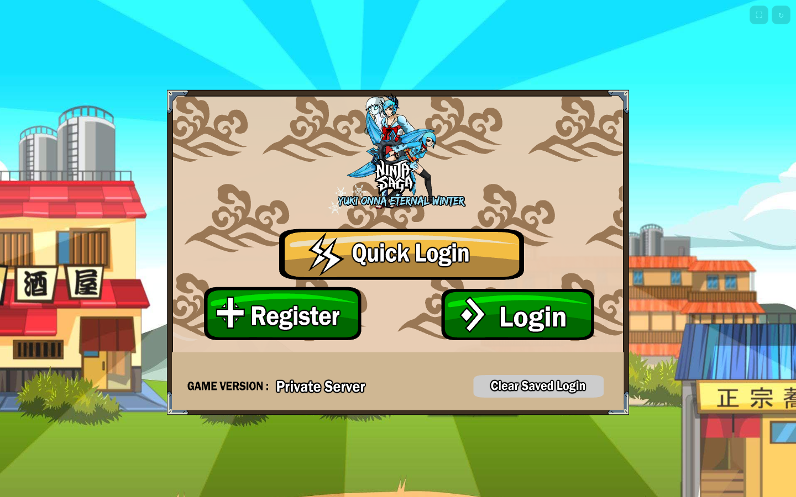

# Ninja Saga · local server (English quick start)

This is a self-contained preservation build of **Ninja Saga** (2009–2021): the original
Flash client, a local Laravel/MariaDB private server, and Ruffle. It runs offline after
installation. Windows 10/11 x64 and macOS are supported.



---

## Windows (one-click)

1. Download the repository (**Code → Download ZIP**) or clone it.
2. Extract it to a short path such as `C:\NinjaSaga` (avoid OneDrive and
   `C:\Program Files`).
3. Double-click **`setup.bat`** once.
   - It downloads portable PHP 8.4, MariaDB 11.4 and Node.js 22 (~160 MB).
   - It creates and seeds the local database.
   - It opens the game when finished.
   - If SmartScreen appears: **More info → Run anyway**.
4. Log in:
   - **Username:** `macninja`
   - **Password:** `ninja1234`
5. Create a character. If the client returns to the login screen after creation, log in
   again; the character is saved.

Next time: double-click **`launch.bat`**.
Stop the server: double-click **`stop.bat`**.

The first install takes 5–15 minutes. The first game load takes 15–25 seconds because
Ruffle downloads the 9 MB client and the WASM engine.

### Requirements

- Windows 10 or 11, 64-bit.
- ~1.5 GB free disk space.
- Internet only for `setup.bat`.
- Google Chrome or Microsoft Edge.
- No administrator rights and no system-wide installation.

### Ports

| Service | Port |
|---|---|
| MariaDB | 3307 |
| Laravel/PHP | 8000 |
| HTTPS edge | 8443 |

All services bind to `127.0.0.1` only.

---

## macOS

Once the project is installed on macOS:

```bash
./launch.command   # play
./stop.command     # stop
```

If the Finder blocks the file: right-click → **Open**, or
`chmod +x launch.command stop.command`.

For a from-scratch macOS install, see the Spanish guide:
[`docs/WINDOWS.md#macos-y-linux`](docs/WINDOWS.md#macos-y-linux).

---

## Accounts

| Account | Username | Password |
|---|---|---|
| Player | `macninja` | `ninja1234` |
| Admin | `admin@admin.test` | `admin` |

Admin panel: `https://ninjasage.test/admin` (use the Chrome window opened by the
launcher). You can also create a new account with **Register** in the game.

---

## Troubleshooting

| Problem | Fix |
|---|---|
| “Site can’t be reached” | Use `launch.bat`; a normal Chrome window lacks the host mapping |
| Certificate warning | Expected: local self-signed certificate; use the launcher |
| Black screen | Wait 15–25 s, then click ↻ |
| `setup.bat` fails | Read `runtime\logs\setup.log` |
| Port already in use | Check 3307, 8000, 8443 with `netstat -ano | findstr :3307` |
| SmartScreen blocks | More info → Run anyway |
| Antivirus quarantines tools | Restore them and exclude `runtime\bin` |
| PHP won’t start | Install the VC++ 2015–2022 x64 redistributable |

Full guide (Spanish): [`docs/SOLUCION_DE_PROBLEMAS.md`](docs/SOLUCION_DE_PROBLEMAS.md).

A harmless error in the logs, `Unsupported type: 0x0D`, is AMF analytics telemetry and
does not affect gameplay.

---

## What is included / excluded

Included: Laravel server, `vendor/`, game data, client assets, patched client, Ruffle,
launcher scripts, patches, screenshots and documentation.

Excluded: the original 118 MB GitHub dump (`repo/`), local databases, downloaded
tools, logs, Chrome profiles, FFDec and backups. See
[`docs/ARQUITECTURA.md`](docs/ARQUITECTURA.md).

---

## Credits and legal

Ninja Saga and all its assets belong to their original creators and rights holders. This
is a non-commercial local preservation project, not an official service.

- Upstream private server:
  [pseudownload/Ninja-Saga-Private-Server](https://github.com/pseudownload/Ninja-Saga-Private-Server)
- Original dump:
  [online-9/ninja-saga-code-dumps](https://github.com/online-9/ninja-saga-code-dumps)
- [Ruffle](https://ruffle.rs/) — open-source Flash player.
- [JPEXS FFDec](https://www.free-decompiler.com/flash/) — SWF decompiler/editor.

The project’s own launcher, proxy, scripts and documentation are released under the MIT
license (see [`LICENSE`](LICENSE)). That license does **not** cover the game assets,
SWFs, fonts or data. Do not redistribute the game as your own or use it commercially.
