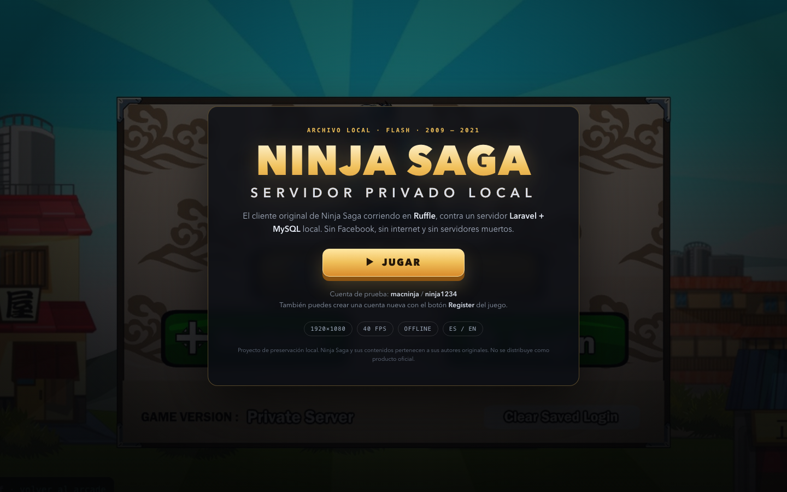
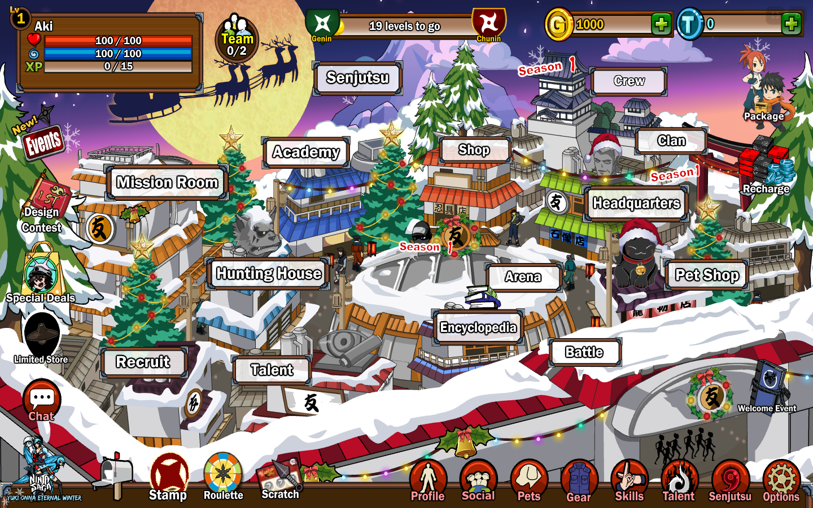
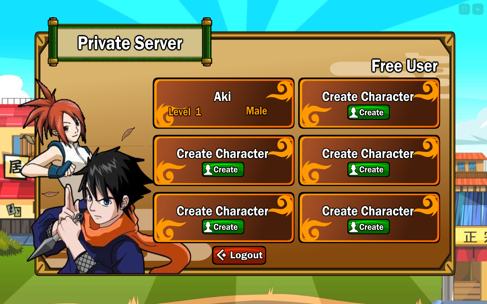
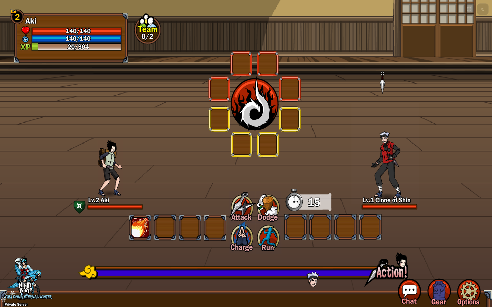

# Ninja Saga · servidor local jugable

**Ninja Saga** (2009–2021) vuelve a funcionar en tu ordenador: cliente Flash original,
servidor privado Laravel/MySQL y Ruffle, todo dentro de una carpeta. Sin Facebook, sin
depender de servidores muertos y sin conexión a internet después de la instalación.

Funciona en **Windows 10/11 de 64 bits** y en **macOS**. La primera vez en Windows se
descarga todo automáticamente con un doble clic.



---

## ▶ Empezar a jugar

### Windows (recomendado para tu amigo)

1. Descarga la última versión desde **[Releases](../../releases/latest)** (recomendado) o
   usa **Code → Download ZIP** en GitHub.
2. Descomprímelo en una ruta corta y sin OneDrive, por ejemplo **`C:\NinjaSaga`**.
3. Doble clic en **`setup.bat`**. Es solo la primera vez.
   - Descarga PHP, MariaDB y Node.js portables (~160 MB).
   - Prepara la base de datos y los datos del juego.
   - Abre el juego al terminar.
   - Si Windows SmartScreen avisa, pulsa **Más información → Ejecutar de todas formas**.
4. Inicia sesión con la cuenta de prueba **Premium**:
   - **Usuario:** `macninja`
   - **Contraseña:** `ninja1234`
   - Incluye **1.000.000 de tokens** y todos los beneficios Premium (más espacios de
     personaje, emblemas, compras y tiradas extra).
5. Elige o crea tu personaje. Si acabas de crear uno, el cliente puede volver al login:
   vuelve a entrar y aparecerá en la lista (es el comportamiento normal).

Para jugar otro día: doble clic en **`launch.bat`**.
Para detener el servidor: doble clic en **`stop.bat`**.

> La primera instalación tarda entre 5 y 15 minutos según la conexión. Después no hace
> falta internet. La primera carga del juego tarda 15–25 s porque Ruffle descarga el
> cliente de 9 MB y el motor WASM.

### macOS

Si ya instalaste el proyecto en macOS:

1. Doble clic en **`launch.command`**.
2. Pulsa **JUGAR** y entra con `macninja` / `ninja1234`.
3. Para parar: doble clic en **`stop.command`**.

Si el Finder bloquea el archivo la primera vez: clic derecho → **Abrir**, o ejecuta
`chmod +x launch.command stop.command` en Terminal.

Para instalar desde cero en otro Mac, consulta
[Instalación manual en macOS](docs/WINDOWS.md#macos-y-linux) o el apartado
[Instalación desde cero](#instalación-desde-cero-macoslinux).

---

## Cuentas

| Cuenta | Usuario | Contraseña | Uso |
|---|---|---|---|
| Jugador de prueba (Premium) | `macninja` | `ninja1234` | Entrar al juego; 1.000.000 de tokens |
| Administrador | `admin@admin.test` | `admin` | Panel `/admin` |

También puedes crear una cuenta nueva con **Register** en la pantalla de login.
Las cuentas y los personajes se guardan en `runtime/mysql`; no se suben a Git.

> `macninja` se crea como cuenta **Premium** (`account_type = 1`) con 1.000.000 de
> tokens. Si ya tenías una instalación anterior, vuelve a ejecutar `setup.bat`: la
> migración `2026_10_22_000001_upgrade_demo_account_to_premium` actualiza la cuenta sin
> cambiar la contraseña ni los personajes.

**Panel de administración:** `https://ninjasage.test/admin` en la misma ventana de Chrome
que abre el lanzador. Permite editar objetos, skills, eventos, economía, etc.

> Cambia la contraseña del admin si vas a dejar el servidor encendido mucho tiempo.
> El servidor solo escucha en `127.0.0.1`, así que no es accesible desde la red local.

---

## Controles

| Acción | Cómo |
|---|---|
| Moverte / interactuar | Clic en el mapa o en los edificios |
| Misiones | **Mission Room** → grado C → misión → ✅ |
| Combate | Botones **Attack / Dodge / Charge / Run** y sellos de elemento |
| Pantalla completa | Botón **⛶** arriba a la derecha o **F11** |
| Reiniciar el cliente | Botón **↻** |
| Salir de pantalla completa | **Esc** |
| Menú de Ruffle | Clic derecho sobre el juego |

---

## Capturas

| Login | Aldea |
|---|---|
|  |  |

| Personajes | Combate |
|---|---|
|  |  |

Más capturas en [`screenshots/`](screenshots/).

---

## Qué incluye este proyecto

- Cliente Flash de Ninja Saga parcheado para Ruffle (sin Adobe AIR).
- Servidor Laravel con gateway AMF, base de datos MariaDB y datos del juego.
- Ruffle 0.7.1 servido localmente (no depende de CDN).
- Lanzador para Windows (`setup.bat`, `launch.bat`, `stop.bat`) y para macOS/Linux
  (`launch.command`, `stop.command`, `runtime/launch.py`).
- Proxy HTTPS local (`runtime/proxy.js`) con certificado autofirmado generado en el
  primer arranque y servidor de assets estáticos.
- Documentación, parches del cliente y scripts de instalación.

### Lo que no se incluye

- `repo/`: el volcado original de GitHub (`online-9/ninja-saga-code-dumps`). Se conserva
  localmente porque no es necesario para jugar y pesa ~118 MB.
- `runtime/mysql/`: tu base de datos, personajes y partidas. Nunca se sube.
- `runtime/bin/`, `runtime/downloads/`: herramientas portables descargadas por `setup.bat`.
- `tools/ffdec/`: FFDec solo hace falta para reconstruir el cliente; el cliente ya
  parcheado sí está incluido.
- Logs, perfiles de Chrome y copias de seguridad.

---

## Requisitos

### Windows

| Requisito | Detalle |
|---|---|
| Sistema | Windows 10 u 11, 64 bits |
| Espacio libre | ~1,5 GB (herramientas + base de datos + assets) |
| Internet | Solo durante `setup.bat` |
| Navegador | Google Chrome o Microsoft Edge |
| Permisos | No hace falta administrador; todo se instala dentro de la carpeta |

`setup.bat` descarga versiones portables y verificadas:

- PHP **8.4 NTS x64** (con `pdo_mysql`, `mbstring`, `openssl`, `curl`, `zip`, `intl`, `gd`).
- MariaDB **11.4.8 x64**.
- Node.js **22.23.4 x64**.

No se instala nada en `Program Files` ni se crean servicios de Windows.

### macOS

- macOS con Google Chrome (o Chromium/Edge).
- PHP 8.2+, MariaDB y Node.js 18+ (`brew install php mariadb node`).

---

## Arquitectura

```
Chrome (perfil dedicado, host mapping + certificado ignorado)
   │
   ├─ https://ninjasage.test/play        → portada + Ruffle
   ├─ https://ninjasage.test/client/...  → NinjaSage.swf parcheado
   ├─ https://ninjasage.test/amf         → Laravel (gateway AMF)
   └─ /items /skills /enemy /game_data…  → assets locales
            │
            ▼
   runtime/proxy.js  (HTTPS 8443, CORS, assets estáticos)
            │
            ▼
   php artisan serve  (HTTP 127.0.0.1:8000)
            │
            ▼
   MariaDB (127.0.0.1:3307, datos en runtime/mysql)
```

| Servicio | Puerto | Log |
|---|---|---|
| MariaDB | 3307 | `runtime/logs/mariadb.err` |
| Laravel / PHP | 8000 | `runtime/logs/laravel-console.log` |
| Proxy HTTPS | 8443 | `runtime/logs/edge-console.log` |
| Juego | Chrome | Consola de Chrome (F12) |

El detalle de por qué existe cada pieza está en
[`docs/ARQUITECTURA.md`](docs/ARQUITECTURA.md).

---

## Instalación desde cero (macOS/Linux)

Solo hace falta si borras `runtime/mysql` o mueves el proyecto a otro Mac. Si ya está
montado, estos pasos sirven para reproducirlo.

```bash
# 1. Dependencias
brew install php mariadb node

# 2. Servidor Laravel
cd "ns-server/Database/Laragon/ninjasage"
composer install            # opcional: vendor/ ya viene incluido
cp .env.example .env
# Edita .env:
#   APP_URL=https://ninjasage.test
#   DB_PORT=3307
#   SKILL_SWF_PATH=".../ns-server/Custom Client/NS Custom Client V1/skills"
#   ENEMY_SWF_PATH=".../ns-server/Custom Client/NS Custom Client V1/enemy"
php artisan key:generate

# 3. Base de datos
cd ../../../..
mariadb-install-db --datadir="$PWD/runtime/mysql" \
  --auth-root-authentication-method=normal --skip-test-db
mariadbd --datadir="$PWD/runtime/mysql" --port=3307 \
  --bind-address=127.0.0.1 --socket="$PWD/runtime/mysql.sock" &
mysql -h127.0.0.1 -P3307 -uroot -e \
  "CREATE DATABASE ninjasage CHARACTER SET utf8mb4 COLLATE utf8mb4_unicode_ci;"

# 4. Datos del juego
cd "ns-server/Database/Laragon/ninjasage"
php artisan migrate --seed

# 5. Volver a la raíz y jugar
cd ../../../..
./launch.command
```

`launch.command` enlaza automáticamente los assets del cliente en `public/` y despliega
el cliente parcheado. No necesitas crear los enlaces a mano.

---

## Solución de problemas rápida

| Problema | Solución |
|---|---|
| `setup.bat` se cierra o falla | Abre `runtime\logs\setup.log`; ejecuta `setup.bat` desde una consola para ver el error |
| Chrome dice “no se puede acceder al sitio” | Usa `launch.bat`; no abras `https://ninjasage.test` en un Chrome normal |
| Aviso de certificado | Es normal: el certificado es local y autofirmado. Usa el lanzador |
| Pantalla negra al entrar | Espera 15–25 s; si sigue, pulsa **↻** o reinicia `launch.bat` |
| No aparece la cuenta de prueba | Revisa `runtime\logs\laravel-console.log`; vuelve a ejecutar `setup.bat` |
| Puerto ocupado | 3307, 8000 o 8443 están en uso. Cierra el otro programa o reinicia |
| Windows Defender bloquea | Permite la carpeta del proyecto o los tres ejecutables en `runtime\bin` |
| Quiero borrar la partida | Para todo, haz copia de `runtime\mysql` y ejecuta `setup.bat --ResetDatabase` |

Guía completa: [`docs/SOLUCION_DE_PROBLEMAS.md`](docs/SOLUCION_DE_PROBLEMAS.md).
Instalación detallada en Windows: [`docs/WINDOWS.md`](docs/WINDOWS.md).

---

## Reconstruir el cliente parcheado

Solo si actualizas el cliente original o quieres reproducir los parches:

```bash
./patches/patch_client.sh
```

Genera `runtime/NinjaSage_patched3.swf` y el lanzador lo copia a
`public/client/NinjaSage.swf`. Los pasos son:

1. `tools/patch_air_stubs.py`: neutraliza `flash.filesystem.File/FileStream/FileMode`
   (Ruffle no implementa Adobe AIR).
2. FFDec `-air -replace … id.ninjasage.Util patches/Util_fixed.as`: recompila
   `Util.url` para que use `Character.cdn` y el host local.

Necesitas Java y FFDec (`tools/ffdec/`), que no se incluyen en Git.

---

## Qué se arregló

El cliente es una app Adobe AIR de 2016–2021. Ruffle no implementa AIR y el servidor no
estaba preparado para macOS/Windows. Los cambios principales:

1. **Error #1014 (`flash.filesystem.File`)** → stubs ABC en el SWF.
2. **Error #1009 en `id.ninjasage.Util.url()`** → recompilado para usar `Character.cdn`.
3. **Botones muertos** → el wrapper de clic reproducía `sfx:click` antes del listener;
   al fallar el sonido, el listener no corría. Con `Util.url` arreglado, carga
   `/sounds/click.mp3`.
4. **Textos en blanco** → fuentes Arial/Verdana/Noto como `fontSources` y `defaultFonts`.
5. **HTTPS y `ninjasage.test`** → proxy local con certificado autofirmado; Chrome se abre
   con `--host-resolver-rules` y `--ignore-certificate-errors`. No se toca `/etc/hosts`
   ni se pide `sudo`.
6. **Servidor** → MariaDB en 3307, migraciones y seeders, lectura directa de
   `public/game_data`, CORS, assets enlazados y placeholders para imágenes muertas.

---

## Estado y limitaciones

- Funcionan el login, la creación de personaje, la aldea, las misiones de grado C y el
  combate. Hay capturas de todo ello en `screenshots/`.
- El evento de telemetría `Analytics.libraries` devuelve un 500 en el log porque el
  payload AMF usa un tipo que el servidor no deserializa. Es telemetría y **no afecta**
  al juego.
- Algunas imágenes de banners de eventos del CDN original ya no existen; se sustituyeron
  por placeholders locales.
- PvP, chat y clanes del servidor privado no se probaron a fondo.
- Ruffle no es Flash Player exacto: puede haber diferencias visuales o sonoras.
- **Windows:** el flujo completo (`setup.bat`, `launch.bat`, HTTPS y base de datos) se
  ejecuta automáticamente en GitHub Actions sobre `windows-latest` con los binarios
  reales. No se probó en un PC físico, pero el
  [smoke test](.github/workflows/windows-smoke.yml) cubre la instalación desde cero.
  Si algo falla en tu equipo, los logs indican exactamente qué paso lo hizo.

---

## Créditos y uso

- **Ninja Saga** y todos sus assets pertenecen a sus creadores y titulares originales.
  Este proyecto es una preservación local sin ánimo de lucro y no está afiliado a ellos.
- Cliente, datos y servidor privado original:
  [`pseudownload/Ninja-Saga-Private-Server`](https://github.com/pseudownload/Ninja-Saga-Private-Server).
- Volcado original: [`online-9/ninja-saga-code-dumps`](https://github.com/online-9/ninja-saga-code-dumps).
- [Ruffle](https://ruffle.rs/): reproductor Flash open source (MIT/Apache-2.0).
- [JPEXS FFDec](https://www.free-decompiler.com/flash/): decompilador/editor SWF.
- Las fuentes Arial/Verdana/Arial Unicode pertenecen a Microsoft y se incluyen solo para
  que Ruffle reproduzca la tipografía del cliente original.

El código propio de este montaje (lanzadores, proxy, scripts y documentación) se publica
bajo licencia MIT; consulta [`LICENSE`](LICENSE). Esa licencia **no** cubre los assets,
SWFs, fuentes ni datos del juego. No redistribuyas el juego como si fuera tuyo ni lo uses
comercialmente. Si eres titular de derechos y quieres que se retire algo, abre un issue.

---

## English quick start

See [`README.en.md`](README.en.md) for a short English guide.

**Windows:** extract to `C:\NinjaSaga`, run `setup.bat` once, then `launch.bat`.
Login: `macninja` / `ninja1234`. Stop with `stop.bat`.
